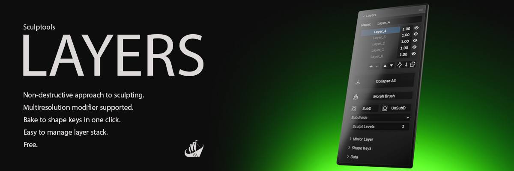

# Sculptools: Layers

**A non-destructive layer workflow for Blender's Sculpt Mode.**

Organize your work into stacked **sculpt layers**. Refine, dial back, hide, reorder, or remove changes at any time without losing earlier work. Works also with **Multiresolution** modifier.

## Features

- **Layer stack** — add, duplicate, remove, reorder (move up/down) and **merge down**
  sculpt layers.
- **Per-layer opacity & visibility** — blend and toggle each layer independently.
- **Automatic saving** — the active layer auto-saves your sculpting process.
- **Morph Brush** — paint to erase part of a sculpted layer, as gradually as you like.
- **Invert Layer** — turn a layer inside out: what was pushed out is pulled in.
- **Mirror Layer** — symmetrize a layer onto the other side, or flip the two
  sides, on X, Y or Z.
- **Multiresolution support** — subdivide / unsubdivide *within* the layer system.
- **Sync Multires** — adopt a Multires modifier you added natively.
- **Bake to Shape Keys** — convert the layer stack into standard shape keys.
- **Data management** — branch or remove an object's layer data.

## Requirements

- **Blender 4.5.0** or newer.

## Installation

**Drag & drop from the Blender Extensions Platform**

Drag the extension from https://extensions.blender.org/add-ons/sculptools-layers/
straight onto a Blender window.

**or install from inside Blender**

Go to **Edit ▸ Preferences ▸ Get Extensions**, search for *Sculptools: Layers*,
and click **Install**.

## Quick start

1. **Enter Sculpt Mode** on the mesh you want to work on.
2. Open the **N-panel** sidebar in the 3D Viewport and pick the **Layers** tab.
3. Click **Add Layer** to create your first layer.
4. **Sculpt as usual.** Your strokes are stored into the active layer automatically —
   there is nothing to press.
5. Need a separate change? **Add another layer** and sculpt on it. Each layer has an
   **eye** (visibility) and an **opacity** button — click the number to open the slider
   and blend the layer.
6. Reorganize with **move up / down**, or **merge** to combine a layer with the one
   beneath it.
7. Press **Shift+left click** on the eye of a visible layer to isolate it. **Shift+left click**
   on the same eye to re-activate all layers visibility.
8. **Sculpted one side only?** Open the **Mirror Layer** panel, pick the **axis**,
   keep **Symmetrize**, choose which side is the source, and click **Mirror Layer** —
   the shape is copied across, reflected. **Flip** swaps the two sides instead. The
   mesh itself has to be symmetric: a Mirror *modifier* doesn't count, and the add-on
   says so rather than mirroring half of it. In the icon row, the button just left of
   **merge down** **inverts** the active layer.
9. **To erase part of a layer:** click **Morph Brush** and paint over the area: each
   stroke removes more of the active layer, following the brush strength, and
   **Ctrl**+stroke brings it back; a mask protects what it covers. Click **Apply
   Morph** to keep the result (or **Cancel** to discard). Only the active layer is
   affected.
10. **Working with Multiresolution?** Use **SubD** inside the add-on to add detail levels,
   not the modifier's own Subdivide. If you added a Multires modifier the normal way,
   click **Sync Multires** so the layer data matches it.
11. **Finishing up:** keep your layers as they are for continued editing, use
   **Collapse All** to flatten them into the mesh, or **Bake to Shape Keys** to produce a
   standard, layer-free result. The baked object appears in a `LAYERS_SHAPE_KEYS`
   collection and your sculpted object is hidden, so you see the result on its own.
12. **Housekeeping:** the **Data** sub-panel offers **Duplicate Data** and **Clean Up
    Unused Data** to keep your file tidy.

> Layers are non-destructive — hiding a layer or lowering its opacity never deletes your
> sculpting. You can always bring it back.

> **On a baked Multires result, do not use the Multires modifier's *Rebuild
> Subdivisions*.** It succeeds on the geometry and **deletes every shape key** without
> warning — the baked mesh is a genuine Catmull-Clark subdivision, so Blender happily
> rebuilds the cage and the keys go with it. Keep the baked mesh dense.

## Credits

Fork credit and attribution are in [CREDITS.md](CREDITS.md).

## License

Released under the **GNU General Public License v3.0 or later** — see [LICENSE](LICENSE).